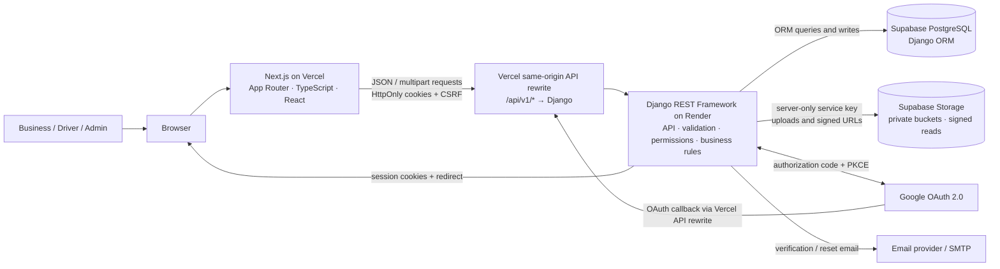
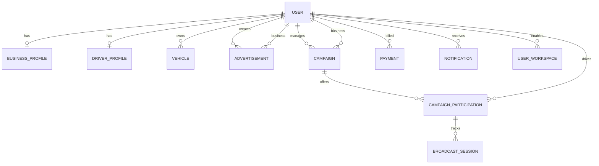

# Fleetcast Platform Architecture

**Meeting overview · 16 November 2026**

## 1. What the platform is

Fleetcast is an Out-of-Home vehicle advertising platform. Businesses use the platform to manage advertising campaigns and creative assets. Drivers submit vehicles and documents for review. Administrators oversee users and approve business, driver, vehicle, advertisement, and campaign records.

The current application provides the web experience, authentication, account/profile management, core CRUD APIs, file storage integration, and administrative review. Ad selection, bidding, GPS tracking, impression measurement, and vehicle hardware integrations are outside the current phase.

## 2. System architecture

### Main responsibilities

| Layer | Technology | Responsibility |
| --- | --- | --- |
| Web client | Next.js 16, React 19, TypeScript, existing plain CSS | Pages, responsive UI, forms, loading/error/empty states, and API calls. |
| Same-origin API path | Vercel rewrite from `/api/v1/*` to Render | Keeps browser API calls and secure auth cookies on the Vercel site origin. |
| Application API | Django 5.2, Django REST Framework | Authentication, authorization, validation, CRUD, filtering, pagination, and business rules. |
| Relational database | Existing Supabase PostgreSQL | Django ORM persistence for application records; legacy Supabase tables and Auth records are preserved. |
| File storage | Existing Supabase Storage | Private advertisement/document buckets accessed by Django only. |
| Identity provider | Google OAuth 2.0 | Verifies Google identity; Django remains the authority for Fleetcast users, roles, and sessions. |

## 3. How a typical request works

1. A signed-in user opens a page or submits a form in the Next.js app.
2. The frontend calls its centralized API client in `src/lib/api/`. In production, the request goes to the same-origin `/api/v1/` path and Vercel rewrites it to the Render Django service.
3. Django authenticates the HttpOnly JWT cookie, checks the server-side role and ownership, validates the input, and applies the request.
4. Django reads or writes relational records with the ORM. For uploads, Django validates file size/type/content and uses its private Supabase service credential to store the object.
5. Django returns JSON; the existing frontend components render the result, loading state, empty state, or error.

Browser JavaScript does not receive access/refresh tokens or Supabase service credentials. Writes carry a CSRF token. On an expired access session, the shared client attempts one refresh and retries the request once.

## 4. Authentication and account roles

All roles use one Django `accounts.User` per email. `accounts.UserWorkspace` stores the user's enabled roles, with a unique `(user, role)` constraint. One user can therefore have both Business and Driver workspaces without duplicate emails or passwords. Each workspace keeps its own one-to-one `BusinessProfile` or `DriverProfile`; the JWT carries the selected active role, and Django checks that membership before authorizing role-specific APIs. Public registration accepts Business and Driver only; administrator access is provisioned by trusted administrative setup. Migration `accounts.0003_userworkspace` backfills each existing user's current role without rewriting user records.

### Email and password

- Registration validates account fields, hashes the password with Django, and sends an email verification link.
- Login checks credentials and the requested enabled workspace, then places short-lived access and refresh JWTs with that active role in secure HttpOnly cookies. Users add another workspace while authenticated in Settings and can switch among enabled workspaces from the dashboard top bar; each selection is checked by Django before tokens are issued.
- Profile, password change, forgot-password, reset-password, email verification, logout, and refresh endpoints are provided by the accounts app.
- Refresh tokens are rotated and blacklisted after use. Mutating cookie-authenticated requests use CSRF protection.

### Google sign-in

The browser begins at Django's Google start endpoint. Django creates a short-lived, one-use OAuth attempt, redirects to Google using the authorization-code flow and PKCE, validates the returned state and nonce, verifies Google's ID token and verified email, then finds or creates the one Fleetcast account. The selected Business or Driver workspace is added to that verified identity if needed; Google does not grant Admin access. Django issues the Fleetcast cookie session for the selected workspace and sends the browser to the frontend callback, which routes the authenticated user to the correct dashboard.

The production callback, Render deployment, and real sign-in flow have been verified. Existing Supabase Auth users are not deleted; a verified Google identity can be transitioned to a Django account under the explicit role-selection and identity-matching rules.

## 5. Django backend modules

The backend is a separate `backend/` project. `config/settings.py` centralizes Django, database, CORS/CSRF, cookie, JWT, storage, and email settings. `config/urls.py` mounts versioned endpoints below `/api/v1/`. Each domain app keeps its models, serializers, views, URLs, and migrations together.

| Django app | Data and current API responsibility |
| --- | --- |
| `accounts` | Custom User, Google OAuth attempts, registration/login/session lifecycle, profile/password flows, user listing, admin dashboard summary, and role permissions. |
| `businesses` | Business profile, logo upload, business dashboard counts, admin business listing and verification decisions. |
| `drivers` | Driver profile/photo, driver dashboard and vehicle counts, admin driver listing and verification decisions. |
| `vehicles` | Driver-owned vehicle CRUD, document upload, status, and admin vehicle review. |
| `advertisements` | Business-owned creative CRUD/upload, status, and admin approval/rejection. |
| `campaigns` | Business-owned campaign CRUD and lifecycle controls; driver discovery/applications; business accept/reject; participation monitoring; current campaign selection; estimated broadcast sessions; idempotent demo campaign seed. |
| `payments` | Business-scoped payment history API and payment records. No live payment processor is connected. |
| `notifications` | User-scoped notification listing and read-state operations. |
| `website` | Contact and playbook lead submissions; the existing public lead tables are mapped without Django taking ownership of their schema. |

Common collection endpoints include `/api/v1/vehicles/`, `/api/v1/advertisements/`, and `/api/v1/campaigns/`; profile/dashboard endpoints are under `/business/` and `/driver/`. Administrative endpoints are under `/api/v1/admin/`. DRF pagination defaults to 25 records, with search/filter/order support on applicable viewsets.

## 6. Core data relationships

`User` is the shared identity record. Business and driver profiles are one-to-one with their user. Vehicles belong to a driver; advertisements, campaigns, and payments belong to a business; notifications belong to a user. A `CampaignParticipation` joins one driver to one campaign with a unique constraint; only one participation can be current per driver. `BroadcastSession` records driver-entered start/stop times and labels measurements as DEMO, ESTIMATED, or VERIFIED. Database constraints and serializer validation cover unique vehicle registration, nonnegative values, campaign date order, and valid session times.

## 7. Existing Supabase data and files

- The existing Supabase PostgreSQL database remains in place; Django connects with `DATABASE_URL` and uses Django ORM for application records.
- A read-only inventory was completed before additive migrations. Existing `contact_submissions`, `playbook_leads`, `profiles`, Supabase Auth users, and policies were preserved. Django does not create a second public profile/auth table for those legacy records.
- The new Django domain tables and framework tables were added after confirming those domain tables did not already exist.
- The last supplied Supabase inventory found no Storage buckets. The campaign seed command can create private `advertisements` and `documents` buckets with a 10 MB file limit when missing, then uploads sample images. Django checks MIME types and file signatures before upload. Private reads use signed URLs. The service-role key exists only in the backend environment.
- Future schema changes still require review. Never reset, drop, or rename existing Supabase tables as part of routine deployment.

## 8. Current frontend pages

The frontend uses the App Router under `src/app/`, with shared UI in `src/components/`, API/auth integration in `src/lib/`, and existing visual styles in `src/styles/`.

| Area | Routes |
| --- | --- |
| Public site | `/`, `/contact`, and existing marketing destinations under `/[...slug]` |
| Account access | `/login`, `/signup`, `/verify-email`, `/reset-password`, `/auth/callback` |
| Business/driver workspace | `/dashboard`, `/dashboard/campaigns`, `/dashboard/campaigns/new`, `/dashboard/advertisements`, `/dashboard/vehicles`, `/dashboard/vehicles/new`, `/dashboard/profile`, `/dashboard/payments`, `/dashboard/notifications`, `/dashboard/earnings`, `/dashboard/settings` |
| Administration | `/dashboard/admin`, `/dashboard/admin/users`, `/dashboard/admin/businesses`, `/dashboard/admin/drivers`, `/dashboard/admin/vehicles`, `/dashboard/admin/advertisements`, `/dashboard/admin/campaigns` |

Role and ownership checks are enforced by Django, not trusted from frontend navigation. Frontend guards and role-aware routing improve the user experience; they do not replace API authorization.

## 9. Data accuracy and current boundaries

Supported counts and campaign participation are queried from Django and show empty states when records do not exist. Driver-entered broadcast time and corresponding earnings are estimates; seeded impressions and performance are explicitly DEMO. Verified impressions, QR scans, spend/revenue analytics, and payment-backed earnings remain unavailable because no measurement/payment system backs them yet. Static examples on public marketing pages are illustrative content, not live account data.

Driver campaign API flow: `GET /api/v1/driver/campaigns/` discovers active campaigns with open slots; `POST /api/v1/driver/campaigns/{id}/apply/` applies; `GET /api/v1/driver/campaigns/mine/` lists a driver's applications and activity. Businesses review entries at `/api/v1/campaigns/{id}/participants/` and accept/reject at `/api/v1/campaigns/{id}/participation/`. Accepted drivers can select a current campaign with `/switch/` and start/stop a timer through `/start_broadcast/` and `/stop_broadcast/`. Pause/completion removes a campaign from discovery, closes open timers, clears current selections, and notifies participants. Timers and associated pay are estimates; no telemetry or hardware confirms broadcast.

Not in the current phase: DSP/SSP bidding, campaign/ad selection algorithms, GPS/live tracking, verified impression collection, hardware communication, and payment processing.

## 10. Deployment and configuration

- **Frontend:** Vercel production at [fleetcast-website-pjcr.vercel.app](https://fleetcast-website-pjcr.vercel.app).
- **Backend:** Render service at [fleetcast-django-api.onrender.com](https://fleetcast-django-api.onrender.com); health check is `/api/v1/health/`.
- **Database/storage:** Supabase PostgreSQL and Storage.
- Production frontend uses `NEXT_PUBLIC_API_URL=/api/v1` and `DJANGO_API_ORIGIN` for the Vercel rewrite. Django secrets, `DATABASE_URL`, Google secret, and Supabase service-role key are configured only in private backend environment settings.
- Local services run independently: Next.js on port 3000 and Django on port 8000. See `README.md` for commands and environment setup.

## 11. Meeting summary

**In one sentence:** Fleetcast is a Next.js web client backed by a Django REST API, with Django owning account security and business rules while Supabase supplies the existing PostgreSQL database and private file storage.

**Implemented:** modular backend apps, custom role-based user model, email/password flows, verified Google OAuth, secure JWT cookies, business/driver profiles, vehicles, advertisements, campaigns, payments/notifications APIs, admin review endpoints, API-driven frontend dashboards, Supabase file validation/storage, and protected resource scoping.

**Still to validate or build:** end-to-end document/creative uploads with real files, full user acceptance coverage for all CRUD/admin flows, configurable production email delivery, and future analytics/payment/tracking/hardware capabilities.
